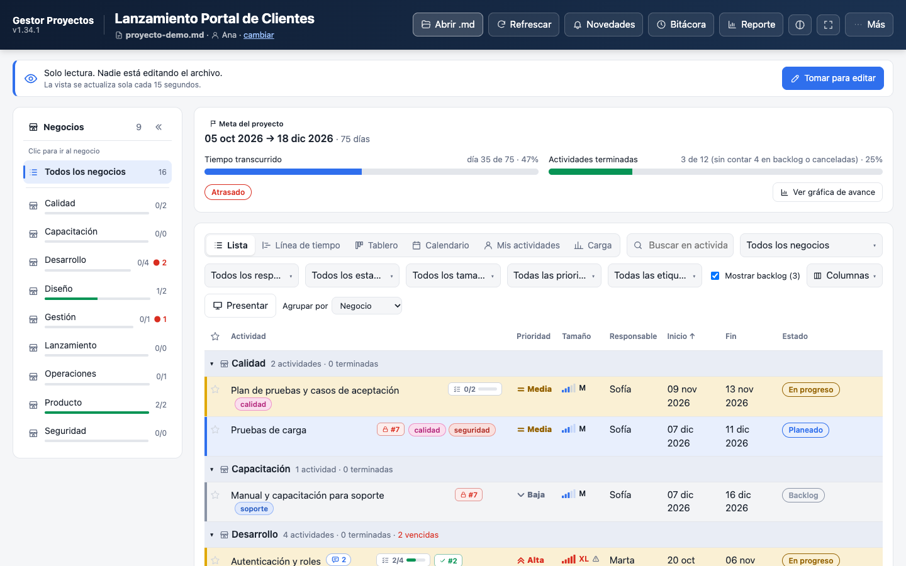
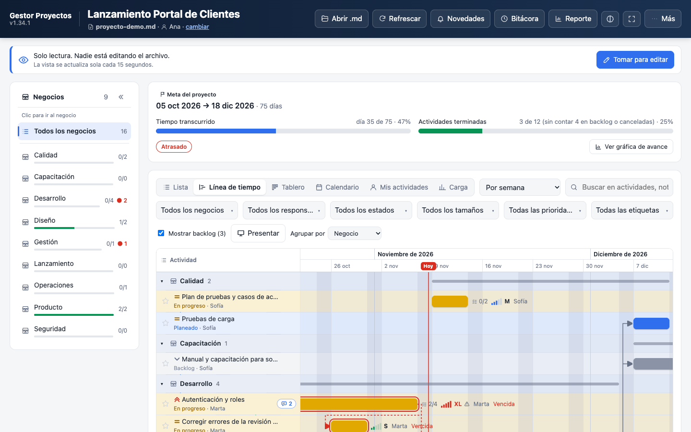
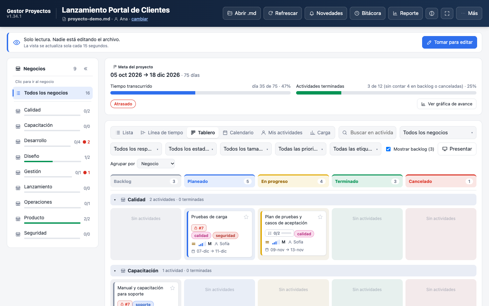
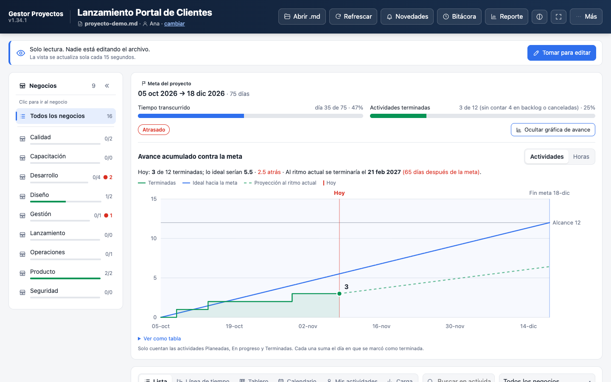

# MDexa

**Actividades de equipos pequeños, donde todo vive en un solo archivo `.md`.**

Sin servidor, sin base de datos, sin cuentas ni suscripciones: el equipo comparte un archivo de texto (en una carpeta de red, Drive, Dropbox…) y la aplicación lo muestra como lista, línea de tiempo, tablero, calendario y reportes. Como el archivo es Markdown normal, también se puede leer y editar a mano, en Obsidian, VS Code o GitHub.



> Aplicación y documentación en **español**. Licencia Apache 2.0.

## Descargas

En la página de [Releases](https://github.com/donotstopme/MDexa/releases/latest) están todas las versiones:

| Sistema | Archivo |
|---|---|
| macOS | `mdexa-<versión>-mac-arm64.dmg` (Apple Silicon) · `mdexa-<versión>-mac-x64.dmg` (Intel) |
| Windows | `mdexa-<versión>-instalador-windows.exe` · `mdexa-<versión>-portable-windows.exe` |
| Linux | `mdexa-<versión>-linux-x86_64.AppImage` · `mdexa-<versión>-linux-amd64.deb` |
| Navegador | `mdexa.html`: un solo archivo, se abre con doble clic en Chrome o Edge |

Cada release publica también la suma de verificación SHA-256 de todos los archivos, para comprobar que la descarga está íntegra (`shasum -a 256 <archivo>` en macOS y Linux, `Get-FileHash <archivo>` en Windows).

### Cómo instalarla

| Sistema | Pasos |
|---|---|
| **macOS** | Abre el `.dmg` y arrastra MDexa a Aplicaciones (elige `arm64` para Apple Silicon: M1 o posterior; `x64` para Macs Intel). Como la app aún no está firmada, la primera vez ábrela con **clic derecho → Abrir**. |
| **Windows** | Ejecuta el instalador `.exe`, o usa la versión portable sin instalar. Si aparece SmartScreen, pulsa **Más información → Ejecutar de todas formas**. |
| **Linux** | `.AppImage`: `chmod +x mdexa-*.AppImage && ./mdexa-*.AppImage`. `.deb`: `sudo apt install ./mdexa-*.deb`. |
| **Navegador** | Descarga `mdexa.html` y ábrelo con doble clic en Chrome o Edge. No instala nada ni envía datos a ningún lado. |

Los instaladores de Windows y Linux se generan en cada release pero todavía no se han probado en equipos reales; si algo falla, abre un *issue*.

## Contenido

- [Descargas](#descargas)
- [¿Para quién es?](#para-quién-es)
- [Qué puedes hacer](#qué-puedes-hacer)
- [Empezar en 5 minutos](#empezar-en-5-minutos)
- [Aplicación de escritorio](#aplicación-de-escritorio-macos-windows-y-linux)
- [Guía de uso](#guía-de-uso)
- [Trabajar en equipo](#trabajar-en-equipo)
- [Formato del archivo](#formato-del-archivo)
- [Tus datos y privacidad](#tus-datos-y-privacidad)
- [Limitaciones conocidas](#limitaciones-conocidas)
- [Preguntas frecuentes](#preguntas-frecuentes)
- [Desarrollo](#desarrollo)
- [Licencia](#licencia)

## ¿Para quién es?

Para equipos de 2 a 15 personas que llevan sus pendientes en Excel, en notas sueltas o en correos y quieren algo más ordenado **sin montar ni pagar una herramienta de gestión de proyectos**. Cada actividad pertenece a un **negocio** (el área, cliente, sucursal o frente de trabajo que prefieras), tiene responsable, fechas y un estado, y se puede ver desde varios ángulos. Sirve igual para un sprint de desarrollo, la operación semanal de una oficina o el seguimiento de una obra.

## Qué puedes hacer

| | |
|---|---|
| **Ver el trabajo de seis maneras** | Lista · Línea de tiempo (Gantt con dependencias) · Tablero (Kanban) · Calendario · Mis actividades · Carga por persona y semana |
| **Describir cada actividad** | Negocio, responsable, tamaño, prioridad, fechas, estado, etiquetas de color, subtareas, notas con `@menciones`, imágenes, dependencias entre actividades y repetición automática |
| **Trabajar en equipo sin servidor** | Quien edita "toma" el archivo y los demás lo ven en solo lectura; los cambios ajenos aparecen solos y se resumen en **Novedades** |
| **Dar seguimiento** | Avance contra la meta del proyecto con gráfica y proyección de la fecha de término, bitácora de quién cambió qué, respaldos restaurables, deshacer y rehacer |
| **Reportar** | Reporte completo (pantalla, PDF, `.html` o `.md`), reporte semanal listo para pegar en un correo y modo **Presentar** para las juntas |
| **Mover datos** | Importar desde Excel o CSV, exportar a CSV, exportar fechas al calendario (`.ics` para Outlook, Google o Apple), crear un sprint nuevo a partir del actual |
| **Trabajar en volumen** | Selección múltiple con cambios en lote, filtros múltiples, agrupar por negocio, responsable, prioridad, estado o etiqueta, renombrar negocios y etiquetas |

<table>
  <tr>
    <td><br><sub>Línea de tiempo: arrastra barras, enlaza dependencias</sub></td>
    <td><br><sub>Tablero: arrastra tarjetas entre estados</sub></td>
  </tr>
  <tr>
    <td colspan="2"><br><sub>Avance acumulado contra la meta, con proyección al ritmo actual</sub></td>
  </tr>
</table>

## Empezar en 5 minutos

**Requisitos:** [Node.js](https://nodejs.org) 22 o superior y **Chrome o Edge** (necesitan poder escribir el archivo; en otros navegadores solo se puede leer).

```bash
git clone https://github.com/donotstopme/MDexa.git
cd MDexa
npm install          # la primera vez tarda: también descarga Electron para la app de escritorio
npm run dev          # abre http://localhost:5173
```

1. Haz una **copia** de [ejemplos/proyecto-demo.md](ejemplos/proyecto-demo.md) (un proyecto de ejemplo con actividades, notas, dependencias y avance).
2. En la aplicación pulsa **Abrir .md** y elige tu copia. Verás el proyecto en modo **solo lectura**.
3. Pulsa **Tomar para editar**, escribe tu nombre cuando lo pida y prueba: cambia un estado, arrastra una tarjeta en el Tablero, mueve una barra en la Línea de tiempo. Cada cambio se guarda al momento en el archivo.
4. Pulsa **Soltar archivo** al terminar.

Para empezar un proyecto propio: **Más → Nuevo .md** (te pide el nombre y las fechas de la meta) o **Más → Importar desde Excel o CSV**.

> ¿Prefieres no instalar nada? [mdexa.html](mdexa.html) es la primera versión del proyecto, de un solo archivo: se abre con doble clic en Chrome o Edge. Las funciones nuevas y las correcciones van en la aplicación de este repositorio.

## Aplicación de escritorio (macOS, Windows y Linux)

La misma aplicación empaquetada con Electron: abre y guarda archivos directamente (sin permisos del navegador), reabre el último archivo y refleja al instante los cambios que otra persona guarde.

```bash
npm run escritorio         # compila y abre la app de escritorio
npm run escritorio:dist    # genera los instaladores del sistema en el que estés
```

Los instaladores quedan en `packages/desktop/release/`:

| Sistema | Archivos |
|---|---|
| macOS | `.dmg` y `.zip` |
| Windows | instalador `.exe` y versión portable |
| Linux | `.AppImage` y `.deb` |

El repositorio incluye un flujo de GitHub Actions ([.github/workflows/escritorio.yml](.github/workflows/escritorio.yml)) que compila los tres sistemas y deja los instaladores como artefactos de cada ejecución.

> Los instaladores **no están firmados**: macOS pedirá abrirla con clic derecho → Abrir (para distribuirla a otras Macs hace falta firmar y notarizar con una cuenta de Apple Developer) y Windows mostrará el aviso de SmartScreen. Hasta ahora la aplicación solo se ha ejecutado en macOS; para Windows y Linux se han generado los instaladores pero falta probarlos en equipos reales.

## Guía de uso

### Conceptos

- **Negocio**: el grupo al que pertenece cada actividad (un área, cliente, sucursal, frente de trabajo…). El panel izquierdo muestra el avance de cada uno.
- **Estados**: `Backlog` (aún sin planear), `Planeado`, `En progreso`, `Terminado` y `Cancelado`. El avance del proyecto solo cuenta lo que no está en Backlog ni cancelado.
- **Tamaño**: `XS` (1 h), `S` (4 h), `M` (1 día, 8 h), `L` (2 días, 16 h) y `XL` (1 semana, 40 h; conviene partirla). Con esto se calcula el esfuerzo y la carga por persona.
- **Meta del proyecto**: un periodo (inicio y fin) contra el cual se mide el avance y se proyecta la fecha de término.
- **Dependencias**: una actividad puede depender de otras (`#12`); si la anterior no termina, aparece como *bloqueada*, y la Línea de tiempo dibuja la flecha.

### Día a día

1. **Abrir .md** y elegir el archivo del equipo. Si nadie lo está editando, verás "Solo lectura".
2. **Tomar para editar** para agregar o cambiar actividades. Se guardan solas; **Deshacer** (Ctrl/Cmd+Z) y **Respaldos** están a la mano. **Soltar archivo** al terminar.
3. Para comentar sin editar, abre una actividad y escribe una **nota**; las notas, subtareas e imágenes se pueden agregar sin tomar el archivo (mientras nadie más lo esté editando). Usa `@Nombre` para mencionar a alguien: lo verá en sus **Novedades**.
4. Cambia de vista con las pestañas o las teclas `1`–`6`; busca con `/`; filtra y agrupa con la barra de arriba.
5. En la junta: **Presentar** (tecla `P`) oculta todo salvo la vista y avanza de negocio con ← →. Después, **Reporte** o **Más → Reporte semanal** para mandar el resumen.

### Ayuda dentro de la aplicación

- **Manual** (botón en la barra de arriba): la guía completa con buscador (escribe una palabra y solo quedan las secciones que hablan de ella; Enter salta a la siguiente coincidencia) y botón para imprimirla. Cubre todo lo que se describe aquí y más: vistas, filtros, notas y menciones, dependencias, respaldos, importar y exportar, sprints, reportes…
- **Atajos de teclado**: tecla `?`.
- Los botones y los íconos tienen una descripción al pasar el cursor encima, y el aviso de la parte superior siempre explica en qué estado está el archivo y qué puedes hacer.

### Atajos de teclado

| Tecla | Acción |
|---|---|
| `1` – `6` | Cambiar de vista |
| `N` | Nueva actividad (con el archivo tomado) |
| `/` | Ir al buscador |
| `P` | Modo presentación |
| `F` | Pantalla completa |
| `Ctrl/Cmd + Z` · `Ctrl/Cmd + Y` | Deshacer · rehacer |
| `Ctrl/Cmd + S` | Guardar ahora |
| `?` | Ver todos los atajos |

## Trabajar en equipo

1. Pon el archivo `.md` en una carpeta que todo el equipo vea (carpeta de red, Drive, Dropbox, OneDrive…).
2. Cada persona abre **ese mismo archivo** con la aplicación y escribe su nombre la primera vez.
3. Quien pulsa **Tomar para editar** deja un **candado** dentro del propio archivo (`- En edición: Ana | …`). Los demás ven quién edita y desde cuándo, en solo lectura, y la vista se actualiza sola cada pocos segundos (al instante en la aplicación de escritorio).
4. Si alguien cierra sin soltar el archivo, a los 5 minutos sin actividad el aviso lo indica y otra persona puede tomarlo.
5. **Novedades** resume lo que otras personas cambiaron o comentaron desde tu última visita; **Bitácora** guarda quién hizo cada cambio.

El candado es un acuerdo guardado en el archivo, no un bloqueo del sistema operativo: funciona muy bien en carpetas de red y en servicios de sincronización rápidos, pero si el servicio tarda en sincronizar, dos personas podrían tomar el archivo casi al mismo tiempo. La aplicación revisa el archivo antes de cada escritura y deja de escribir si otra persona lo tomó, pero conviene coordinarse con el equipo.

## Formato del archivo

Un `.md` normal: encabezado con el proyecto y la meta, una tabla de actividades y secciones `##` para etiquetas, notas, subtareas, imágenes y bitácora. Se puede editar a mano con cuidado.

```markdown
# Mi proyecto

- Proyecto: Mi proyecto
- Meta inicio: 2026-10-05
- Meta fin: 2026-12-18
- Versión de MDexa: 18 (v1.34.1)

| ID | Negocio | Actividad | Tamaño | Prioridad | Responsable | Inicio | Fin | Estado | Terminada | Etiquetas | Depende de | Repite |
|---|---|---|---|---|---|---|---|---|---|---|---|---|
| 1 | Producto | Definir alcance | M | Alta | Ana | 2026-10-05 | 2026-10-09 | Terminado | 2026-10-08 | planeación | |  |
| 2 | Diseño | Wireframes | L | Alta | Luis | 2026-10-15 | 2026-10-28 | En progreso |  | diseño | #1 |  |

## Notas

- #2 | 2026-10-20T15:30:00.000Z | Luis | Falta el logo final. @Ana ¿lo tienes?
```

- Las secciones `##` que la aplicación no conoce (por ejemplo, una que agregues a mano) se conservan al guardar.
- Un archivo guardado por una versión **más nueva** se abre en solo lectura, para no borrar información que esta versión no entiende.
- Las imágenes se guardan en una carpeta `nombre-del-archivo-imagenes/` junto al `.md` y se enlazan desde la sección `## Imágenes`, así también se ven en Obsidian, VS Code o GitHub.

## Tus datos y privacidad

- **Nada sale de tu equipo ni de tu carpeta compartida**: no hay servidor, ni telemetría, ni cuentas. Tus actividades están únicamente en el `.md` (y las imágenes, en su carpeta).
- Cada equipo guarda por su cuenta, solo para sí, qué has visto (para las Novedades), tus favoritas, tus preferencias de pantalla y los **respaldos** automáticos (hasta 40 por archivo). En el navegador viven en su almacenamiento local; en la aplicación de escritorio, en su carpeta de datos. No se comparten con el equipo.
- Como el archivo es de texto, funciona con cualquier control de versiones (Git) si quieres historial adicional.

## Limitaciones conocidas

- Escribir archivos desde el navegador requiere **Chrome o Edge**; Firefox y Safari solo leen.
- Un proyecto es un archivo: no hay permisos por persona ni cuentas (quien puede abrir el archivo puede editarlo).
- El candado depende de la velocidad con que sincronice la carpeta compartida (ver [Trabajar en equipo](#trabajar-en-equipo)).
- La aplicación de escritorio aún no está firmada y solo se ha ejecutado en macOS.
- El ícono de la aplicación de escritorio es provisional.

## Preguntas frecuentes

**¿Necesito internet?** No. Todo funciona sin conexión; sólo hace falta que la carpeta compartida esté disponible si trabajas en equipo.

**¿Qué pasa con mis archivos de versiones anteriores?** Se abren sin cambios. Al guardar, el encabezado pasa a decir `Versión de MDexa` (antes decía otra cosa), y el resto del formato no cambia. Un archivo guardado con una versión más nueva se abre en solo lectura.

**¿Se conservan mis preferencias y respaldos de versiones anteriores?** No: MDexa guarda sus preferencias (vista, tema, filtros, favoritas) y los respaldos con nombres nuevos, así que empiezan vacíos. Tus actividades no se tocan porque viven en el `.md`.

**¿Puedo editar el `.md` a mano mientras alguien usa la aplicación?** Mejor no: si alguien tiene el archivo tomado, tus cambios podrían pisarse. Espera a que lo suelte o coordínate con quien lo edita.

**¿Cuál uso, la aplicación de escritorio o el navegador?** La de escritorio guarda directo y refleja al instante los cambios ajenos, sin pedir permisos. El navegador no requiere instalar nada, pero necesita Chrome o Edge para escribir.

**¿Se puede usar con Git, Obsidian o VS Code?** Sí: es un Markdown normal, y las imágenes quedan en una carpeta junto al archivo.

## Desarrollo

Monorepo de npm con tres paquetes:

| Paquete | Qué contiene |
|---|---|
| [packages/core](packages/core) | La lógica en TypeScript puro y con pruebas: lectura y escritura del `.md`, filtros, reportes, avance, CSV, `.ics`, candado, bitácora… |
| [packages/app](packages/app) | La interfaz en React + Vite |
| [packages/desktop](packages/desktop) | La aplicación de escritorio (Electron) y su empaquetado |

```bash
npm install
npm run dev               # la app en el navegador (http://localhost:5173)
npm test                  # pruebas de los tres paquetes
npm run typecheck         # revisión de tipos
npm run build             # compila la app web (packages/app/dist)
npm run escritorio        # compila y abre la app de escritorio
npm run escritorio:dist   # instaladores del sistema actual
```

- La interfaz reutiliza el CSS y la estructura del HTML original; antes de inventar estilos, busca la clase en `packages/app/src/original/original.css`.
- Si Electron no arranca desde un IDE, quita la variable `ELECTRON_RUN_AS_NODE` del entorno (`env -u ELECTRON_RUN_AS_NODE …`).
- [CLAUDE.md](CLAUDE.md) documenta la arquitectura, las convenciones y las decisiones técnicas (está escrito para asistentes de código, pero sirve como guía para cualquier persona que contribuya).
- Si cambias lo que se guarda en el `.md`, actualiza `parseMD` y `toMD` en `packages/core` y sube `VERSION_MDEXA`.

## Licencia

[Apache 2.0](LICENSE).
